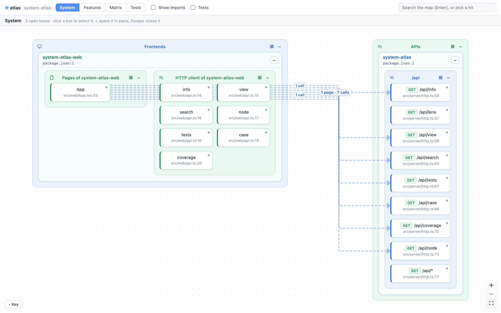
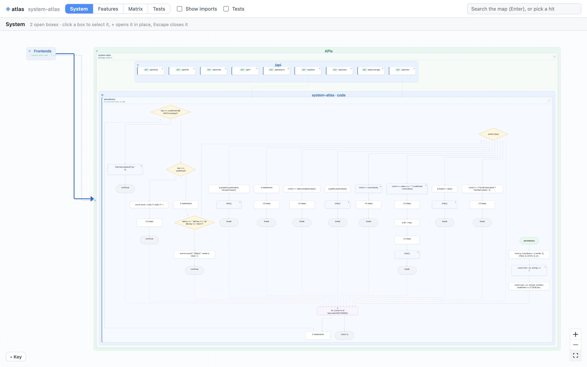
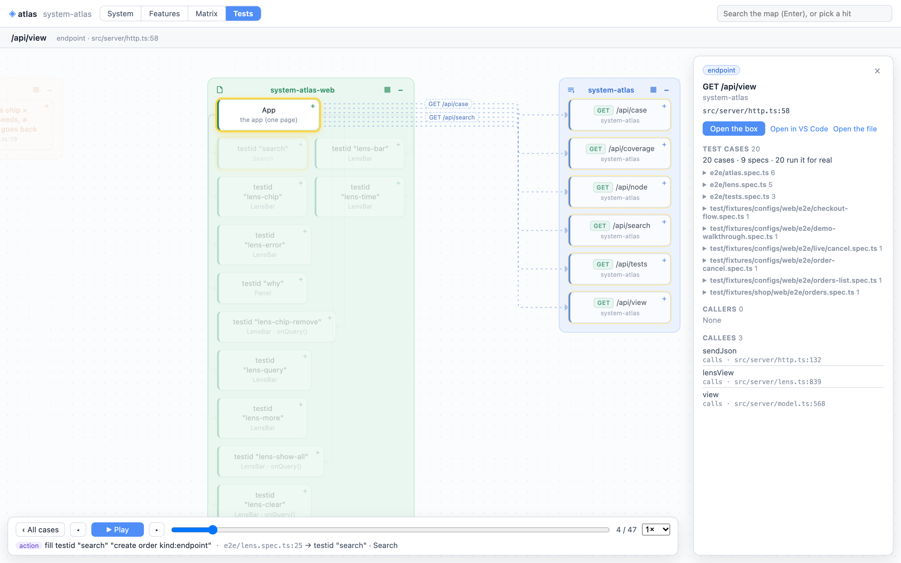
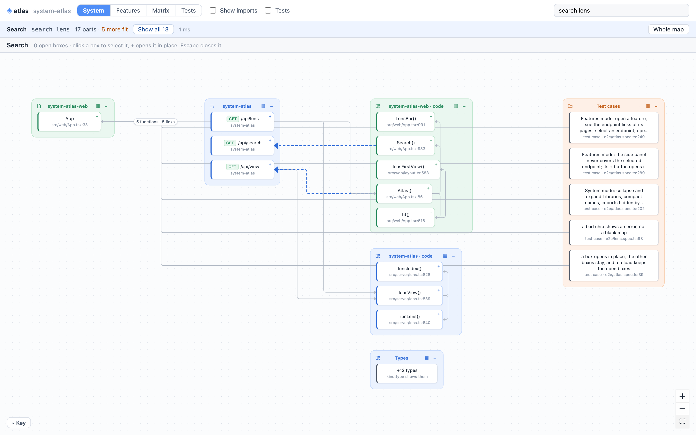

# System atlas

**One page that maps the projects of a repo. Open a box in place to see its pages, routes and the flow chart of each function.**



The atlas reads your repo on your machine. It finds the projects (frontends, APIs, workers, tools, libraries), the HTTP calls between them, the data stores and the e2e test cases. It shows them on one canvas. You open a box in place to see what is inside it: the pages of a frontend, the routes of an API, and the flow chart of a page, route or function. The other boxes stay on the canvas.

The code facts come from [CodeGraph](https://github.com/colbymchenry/codegraph), a local SQLite index made with tree-sitter. The atlas uses no LLM and no network.

## Install

You need Node.js 24 or later.

```sh
npx system-atlas serve path/to/repo
```

Or install the `atlas` command:

```sh
npm i -g system-atlas
atlas serve path/to/repo
```

Or run it from the source:

```sh
git clone https://github.com/raizal/system-atlas.git
cd system-atlas
npm ci
npm run build
node bin/atlas.js serve path/to/repo
```

## Quick start

```sh
atlas serve <repo>                  # open http://127.0.0.1:4890/
atlas serve <repo> --port 4899      # use another port
atlas index <repo>                  # make or rebuild the index only
atlas test <repo> [<spec>] [-g <name>]   # run the Playwright specs of the repo (see Tests)
atlas serve <repo> --results <dir>  # show the results of a test run that you made
```

`atlas serve` uses the index in `<repo>/.codegraph/` if there is one. If there is no index, it makes one first and tells you that it writes `<repo>/.codegraph/`. `atlas index` always rebuilds the index. CodeGraph is the only part that writes to the repo, and it writes to `<repo>/.codegraph/` only. Add `.codegraph/` to the `.gitignore` of the repo.

## Privacy

- **CodeGraph telemetry is off.** CodeGraph has anonymous telemetry. The atlas always turns it off: `bin/atlas.js` sets `CODEGRAPH_TELEMETRY=0` and `DO_NOT_TRACK=1` before it loads CodeGraph, and each CodeGraph run and each test run gets the same env.
- **127.0.0.1 only.** The server listens on 127.0.0.1. It does not listen on other interfaces.
- **No network.** The atlas sends no code, paths or names to any place. It uses no LLM and no embeddings.
- **Read only.** The JSON API is GET only. Other methods get a 405. A request with an `Origin` header from another host gets a 403. The server does not run tests: it reads the results of the last `atlas test` run (or of `--results <dir>`).

## The page

- One canvas. Click **+** on a box to open it in place. The other boxes move aside.
- The path strip at the top shows the open boxes. Click **×** on a box in the strip to close it, or push Escape to close the open box that holds the selected box.
- The open boxes are in the URL hash, so you can share or reload a view.
- Search: type words. A click on a hit opens the path to it. A function hit shows as a box in the **code** group of its project, and its **+** opens its flow chart. Enter shows the search lens (see below).
- The edges between boxes stay faint until you hover or select a box. Hover an edge to see its label.
- Three or more links into the same box make a bundle: one trunk, one arrowhead and one total label ("19 pages · 23 endpoints"). Hover or select one link to draw it solid.
- A long name breaks only at `-`, `_`, `.` or `/`. Else it is cut with "…", and the full name shows on hover.

Levels:

- **System**: the projects in lanes. A dashed blue line is an HTTP link. A gray line with a count is an import link.
- **Project**: a frontend shows its pages and the APIs that it calls. An API shows its routes, grouped by the first part of the path, with the method.
- **Flow chart**: the steps of a page, route or function. Open a call step to see its flow chart in place. A step that calls another project over HTTP has **⇢ expand target**.



## Modes

The switch in the top bar has four modes. The mode is in the URL hash (`#/?mode=features`).

### System

All projects, in fixed lanes from left to right: Frontends → APIs → Functions and workers (and command-line tools) → Data stores. Libraries and Support are shelves along the bottom. All HTTP links go from left to right.

- Only runtime links show: HTTP calls and data stores. Tick **Show imports** to show the import links. A selected project always shows its own import links.
- Click a project to focus it: the boxes with no link to it fade. Escape or a click on the canvas clears the focus.
- The size of a box shows the count of its pages, routes or exports, in 4 steps. A very small project is a chip with its name only.
- Zoom out below 0.6 to see the group names, the large projects, and the totals between groups ("Frontends → APIs · 37 calls").
- Each group has **−** (collapse) and **▦** (compact) in its head. A collapsed group is one row: its name and a count ("25 libraries"). **+** expands it. A compact group shows the names only. Libraries and Support start collapsed when they have more than 12 projects. The hash keeps these choices.

### Features

The pages of each frontend, in features, and the endpoints that they call.

- A feature is a group of pages by the first part of the route after the common prefix (`/orders/*`, `/invoices/*`). A very large group splits by the next part. A group of one page goes to **Other pages**.
- At first, each frontend has one link to each API box, with a count ("12 endpoints"). Select or open a feature to see its own links.
- Open a feature to see its pages. Each page links to the endpoints that it reaches. The atlas follows the CodeGraph calls from the page component down through components, hooks and services to the HTTP calls: at most 6 steps, and at most 40 calls out of one function.
- The label of a link says **direct** (the call is in the page file) or **via N steps**. A link with no sure endpoint is **possible**: dashed and lighter.
- A page that calls an API route of its own frontend (a Next.js route), which calls a backend route, links to the backend endpoint. The label shows the middle hop (`via GET /api/orders`).
- **shared · N features** marks an endpoint that more than one feature uses. Open an endpoint to see its handler flow chart.
- Each API box shows its HTTP method mix when it fits ("GET 9 · POST 4").

### Matrix

The frontends are the rows, the projects that they call are the columns. A cell shows the direct and the possible calls. Click a cell to go to the System mode with the two projects open and filtered to the cell. The strip shows a chip ("Filter: shop-web → shop-api ×"). Click **×** to clear the filter.

### Tests



The e2e test cases of the repo (Playwright specs; Cypress specs show for review only), and how each case goes through the system.

- **The list**: one group per project, the project with the most cases first. In a group, the cases are by spec and describe, with the result of the last run and the tags (`@smoke`, `{ tag: '@p1' }`). Each row shows the areas of the case ("1 feature · 2 pages · 5 components · 3 endpoints").
- **The filter box** keeps the cases whose title, describe, file, project or tag has all the words.
- **Coverage by area**: one row per feature of a frontend, with the count of cases, the pages with a case, and the endpoints that a case reaches for real, that only a mock touches, and that no case touches. Click a row to show only the cases of that area.
- **Areas this case touches**: the parts of the project that the case touches, by layer (feature, pages, components, handlers, frontend API routes, backend endpoints, backend functions and stores). Each item says how: visited, clicked, filled, asserted, mocked, seen in a run, or "reached by code only".
- **Used and registered mocks**: a fixture can mock many routes. A mock is **used** if it is a `page.route` in the test itself, if an assert names it, or if a client call is in a function that a visited page reaches. The other mocks of a fixture go on one collapsed line ("Fixture orderApi also mocks 4 routes that this page does not call").
- **What this case checks**: the asserts of the case in order, in short words ("the button "Save" shows", "the URL is /orders/new").
- **Review**: the steps of the case are a flow chart on the left. A helper, a `test.step` and a hook (`beforeEach`) are groups of steps. On the right are the parts of the map that the case touches: `page.goto` goes to a page (in a case with no mock, also to the GET endpoints that the code of the page calls, as possible areas), an action (`click`, `fill`, …) goes to the JSX element with the same role and text, `page.route` mocks an endpoint, and `expect` is an assert.
- **Simulate**: the player at the bottom has **‹ All cases**, Back, Play/Pause, Step, a slider and the speed. The current step and its target are lit, and the link from the page to the endpoint moves. The case and the step are in the URL hash (`#/?mode=tests&case=<spec>:<line>&step=2`).

Tick **Tests** in the System or Features mode to see the test coverage: each page, endpoint, component and handler shows the count of the cases that touch it. A page with no case has a hollow **0**. Select a box: if a case touches it, the side panel has a **Test cases** section.

#### atlas test

```sh
atlas test <repo>                          # all the Playwright specs of the repo
atlas test <repo> web/e2e/orders.spec.ts   # one spec (from the repo root)
atlas test <repo> web/e2e/orders.spec.ts -g "saves"
```

- It runs `npx --no-install playwright test` with the config of the spec, `--trace on` and the JSON reporter. The repo must have Playwright installed. The atlas installs nothing.
- The report and the traces go to the cache folder of the atlas, not to the repo: `$ATLAS_CACHE_DIR`, or `$XDG_CACHE_HOME/system-atlas`, or `~/.cache/system-atlas`. The command prints the folder. The page then shows the status of each case, ✓ on a passed assert, and ✗ on the step that failed. The trace gives the real requests of each step.
- A project can have more than one Playwright config (`playwright.config.ts`, `playwright.demo.config.ts`, `playwright.staging.config.ts`). The atlas reads each one as text. A spec runs with the main config if that config runs it, else with its own config. The list shows the tag of that config ("demo", "staging (live stack)").
- It does not run: a spec with no Playwright config, a config whose `baseURL` is not on this machine, a config of a live stack (a name with `golden`, `live`, `staging` or `prod`), a test automation project (`qa-tests`, `acceptance-tests`, …) and a setup file alone. Run those yourself, and show the results with `atlas serve <repo> --results <dir>`. The folder must have the JSON report (`report.json`, or a JSON file with `suites`) and the `trace.zip` files.

## The search lens



Type words in the search box and push Enter. The map shows only the parts that fit the words, in lanes: Frontends → APIs → Functions → Data stores → Tests.

- The seeds are the pages, endpoints, API routes, functions, types, data stores and test cases whose name or route path has a word of the query. Words are split (`createOrder` → create, order) and a plural fits the singular.
- The lens shows the best seeds: at most 8, cut where the score drops (at least 2). Types and constants go in one **+N types** box. Click it (or add `kind:type`) to show them.
- From each seed, the lens follows the real links, up to 4 steps: a page → its API route → its endpoint → its handler → its data store.
- The lens brings in at most 5 test cases: the cases that touch most parts of the lens.
- The chain of the best seed is the main chain. It is lit.
- **Show 20 more** and **Show all N** add seeds.
- Click an item to see why it is there (`"create" in the name`, `POST fits "create"`, `App calls it`).
- The query is in the URL hash (`#/?q=…`), so a reload keeps it. **Whole map** goes back to the System view.

The rank uses facts only: a name that is the same as the query (`parseQuery`, `parse_query`) is first; the words of a camelCase or snake_case name count one by one; more words that fit rank higher; a page, endpoint or route ranks above a function; a word in the route path is strong; a verb fits a method (create, add, new → POST; delete, remove → DELETE; update, edit → PUT, PATCH; list, get, show → GET); a name with many users goes down; a test, mock or fixture file goes down.

Filters (each filter shows as a chip; click **×** to remove it; a bad filter gives an error, not a blank map):

| Filter | What it does |
| --- | --- |
| `project:<name>` | Only the items of this project. |
| `kind:<kind>` | Only this kind: `page`, `endpoint`, `route`, `function`, `type`, `store`, `test`. A `kind:` filter has no score cut. |
| `method:<GET\|POST\|PUT\|PATCH\|DELETE>` | Only the endpoints and routes with this method. |
| `path:<glob>` | Only the routes with this path. `*` is one part, `**` is any parts. A path with no `*` fits the paths that start with it. |
| `show:N` | Show the best N seeds and their chains (1 to 60). |
| `depth:N` | A wide lens: the links in all directions, N steps (0 to 5, default 2). `depth:0` shows the seeds only. |
| `up:` / `down:` | Follow the links in one direction only. `up:1` also sets the depth. |
| `impact:"<name>"` | The items that use this name (up, depth 3). |
| `untested` | Only the items that no test case touches. |

The map shows at most 60 items. The bar says how many more items fit.

## The config file (optional)

Put `atlas.config.json` in the root of the repo to change the System view. The atlas only reads it. A bad file or a bad item gives a note in the strip, not an error.

```json
{
  "projects": {
    "shop-api": { "pin": true, "rename": "Shop API" },
    "ui-playground": { "hide": true },
    "shared-types": { "group": "library" }
  },
  "features": {
    "shop-web": {
      "rename": { "orders": "Orders" },
      "merge": { "orders": ["order-history"] }
    }
  },
  "aliases": { "po": "purchase order", "sku": "stock item" }
}
```

- `projects` (by project name): `pin` puts the project first in its group and keeps it out of Support. `hide` removes it from the canvas. `rename` changes its label. `group` moves it to one of `frontend`, `api`, `worker`, `cli`, `library`, `support`.
- `features` (by frontend name): `rename` gives a feature (by its slug) a new label. `merge` moves the pages of the listed features into the feature of the key.
- `aliases` (for the search lens): a query word that is a key changes to the value before the search. The key is one word. The swap is exact: `po` changes, `pos` does not.

The **Support** group gets the projects whose name or folder matches `*/infra`, `template*`, `*playground*`, `docs`, a test automation project (`qa-tests`, `acceptance-tests`, …) or `scripts`, and the projects with no pages, routes or exports and no runtime link.

## How it works

1. `atlas index` runs CodeGraph on the repo. CodeGraph parses the code with tree-sitter and writes a SQLite index to `<repo>/.codegraph/`: the files, functions, classes, calls, imports and routes.
2. The server reads the index and the source files and builds the map:
   - **Projects**: the folders with a `package.json`, `pyproject.toml`, `setup.py`, `requirements.txt` or `go.mod` above the source files. One package with a web page (React, Vue, Svelte…) and other code (a server, a tool) has two parts: the folder of the page (the `root` of the Vite config, the script of `index.html`, or `src/web`, `client`, `frontend`…) is a frontend of its own (`<name>-web`), and the rest is the server.
   - **Methods**: a route with no method of its own gets the method of the server guard (`if (req.method !== 'GET') … 405` gives GET). With no guard, it is ANY.
   - **Routes**: the CodeGraph route nodes (Express, FastAPI, Next.js and others). For FastAPI, the atlas adds the prefix of `app.include_router(…, prefix=…)`, also when the prefix is a settings value.
   - **HTTP calls**: the `fetch`, axios and client calls in TypeScript and JavaScript files, read with tree-sitter. An HTTP helper (a function with a path parameter that calls `fetch(`${BASE}/v1${path}`)`) is read too, also in another file: `await callApi<T>('/orders', { method: 'POST' })` is `POST /v1/orders`. A call to a proxy route of the frontend (`/api/backend-proxy/v1/jobs`) links to `/v1/jobs` of the API with that word in its name. A call to a route of its own project is not a link.
   - **Test cases**: the Playwright and Cypress specs, read with tree-sitter: the steps, the helpers, the fixtures, the mocks and the asserts.
3. The page (React and React Flow) asks the server for one view at a time and lays it out with ELK.

## Development

```sh
npm ci
npm run typecheck
npm test          # unit tests; some index a copy of a fixture in a temp folder
npm run build
npm run e2e       # Playwright; run `npm run build` first
npm run dev       # Vite, with a proxy to an atlas server on port 4890
```

The e2e copies the shop fixture (`test/fixtures/shop`: a frontend, an API, a tool, a library, two data stores and an e2e spec) to a temp folder, indexes it, and serves the atlas of it on port 4891 (`ATLAS_E2E_PORT` changes it). It needs no other repo. The first run needs a browser: `npx playwright install chromium`.

## License

[MIT](LICENSE) © 2026 Raizal I.N. Pregnanta

## Credits

The atlas reads the index of [CodeGraph](https://github.com/colbymchenry/codegraph) (MIT). Thank you to its authors.
